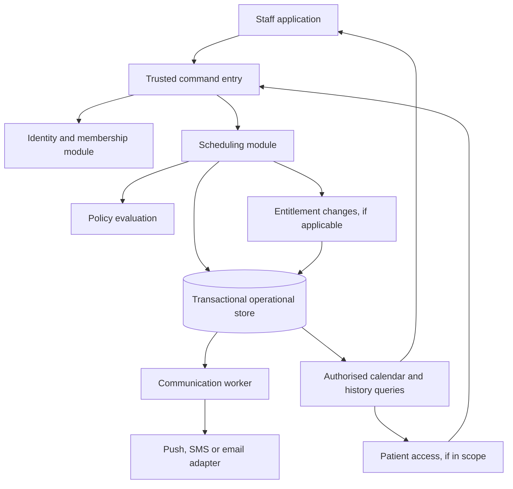
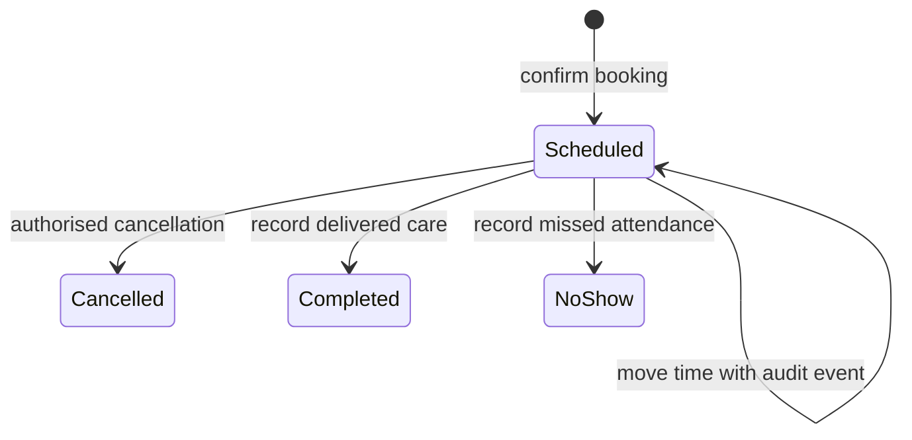

# Product decisions and a candidate architecture

Date: 26 September 2026. Status: **discussion material, not approved requirements or an implementation plan**.

This document proposes a coherent alternative to reason about. It deliberately leaves policy values open. Existing specs remain historical evidence; no new `CONTEXT.md` or accepted ADR has been written because the owner has not yet settled the terminology or trade-offs in this discussion.

## 1. Decide the product promise before its feature list

There are at least three distinct products we could be building:

| First customer | First useful outcome | Decisions that become urgent |
| --- | --- | --- |
| One clinic | Reception can maintain a reliable diary and patients know their next visit | Staff workflow, walk-in/phone bookings, therapist leave, cancellations, appointment reminders |
| Several branches of one clinic business | Coordinate people and resources across locations | Shared patients, cross-location staff, access by branch, travel/buffers, consolidated reporting |
| Independent clinics buying a platform | Each business operates safely and independently | Tenant provisioning, configurable policies, billing for the product, data isolation, support and export |

None is assumed. The first success measure should describe a real result—for example, staff can move a visit once, immediately see the free old time and occupied new time, and understand the patient's remaining entitlement. “Has scheduling” is too vague to validate.

Also establish why custom software is needed. If this is solely for operating one clinic, the differentiated workflow must justify its maintenance cost. If this is a product business, define the particular clinics and unmet need before imitating ten vendors.

## 2. Proposed vocabulary for our conversation

These definitions distinguish concepts currently bundled into `UserModel` and `treatmentPlans`. They are candidates for a future glossary, not additional tables or launch features by default.

| Term | Proposed meaning | Why the distinction matters |
| --- | --- | --- |
| Clinic business | The organisation controlling a clinic's operational records | A branch/location may not be an independent tenant |
| Location | A physical or virtual place where care is delivered | Working hours, rooms and time zones can differ |
| Patient record | The person receiving care, whether or not they have a login | Reception can book someone who does not use an app |
| Login account | An authenticated account, linked to one or more sign-in methods and patient/staff relationships | An account is distinct from a person or phone number; a parent may manage a child and a staff member may also be a patient |
| Membership | An account's role and access within a clinic business | Role should not be editable patient profile data |
| Appointment | A specific reservation of time and required resources | Cancelling or moving it changes capacity |
| Recurring series | A rule linking repeated appointments | Changing one occurrence need not change the whole series |
| Care episode | Related treatment for a particular clinical concern | Clinical progress need not equal payment or booking count |
| Visit entitlement | A right to a defined amount/type of treatment under an agreed package | Losing a calendar booking does not inherently remove or create a credit |
| Policy version | The rules recorded as applicable to a particular action/booking | A later settings change should not silently rewrite historical consequences |
| Waitlist entry | A patient's stated willingness to accept suitable capacity | It is not an appointment or a reservation |
| Hold | A time-bounded reservation before a confirmed booking | Its owner, scope, expiry and exclusivity must be explicit |
| Payment/refund | A financial transaction, distinct from attendance and entitlement | A cancelled appointment can still have a paid invoice or pending refund |

We should particularly challenge the term **treatment plan**: does it mean a clinician's intended care, a purchased ten-visit package, or a repeating diary rule? One thing may link to the others, but making them the same entity creates accidental policies.

## 3. Scheduling decisions that must be explicit

| Decision | Real alternatives | Concrete question to settle |
| --- | --- | --- |
| Booking authority | Staff creates; patient requests; patient confirms directly | Does selecting a time guarantee a booking or start an approval process? |
| Identity requirement | Staff-created patient; guest booking; portal account | Can someone be booked without owning a phone/account? |
| Appointment duration | Fixed slots; service-specific durations; individually adjustable | Can a 45-minute first assessment overlap a 30-minute follow-up? |
| Resources | Therapist only; therapist + room/equipment; capacity greater than one | What must be reserved, and can group care occur? |
| Availability | Weekly hours plus dated overrides, leave and closures | What happens to existing bookings when a therapist takes leave? |
| Patient conflicts | Block; warn/override; allow certain concurrent activities | Can a patient have two overlapping bookings with different therapists? |
| Recurrence | Finite exact dates; bounded rolling horizon | Do eight weekly visits reserve all eight dates immediately? |
| Conflict in a series | Reject all; present partial preview for confirmation; explicitly skip | If visit four conflicts, are the other seven saved? Never silently change the promise. |
| Series edits | This occurrence; this and following; all eligible future visits | What happens to previously moved exceptions? Preserve completed history. |
| Online window | Minimum notice and maximum horizon | Can patients book for today? Does staff have a reasoned override? |
| Provider continuity | Same therapist only; patient can switch; staff approval | Does a change require a different duration, price or clinical approval? |
| Renewal | No reservation; explicit short hold; clinic-specific priority | Why would a completed course reserve a weekly time for another 30 days? |

The current fixed global slots, 365-day generation cap, admin-only mutations, same therapist for the series, automatic replacements and 30-day renewal holds are previous implementation assumptions. Each deserves validation; none is an industry requirement.

## 4. Cancellation is several decisions, not one status change

For every case, separately decide (1) calendar capacity, (2) attendance/history, (3) visit entitlement, (4) charges/refunds, and (5) communication. Late cancellation can be a cancellation reason/policy outcome rather than a second independent lifecycle.

| Case | Candidate calendar/history outcome | Entitlement and money decision | Human choice still needed |
| --- | --- | --- | --- |
| Patient cancels with sufficient notice | Release capacity; retain cancellation event | Restore/retain entitlement if policy says so; refund is separate | Notice threshold, definition of sufficient notice, any fee |
| Patient cancels late | Release capacity; record lateness and reason | Consume credit, charge a fee, waive, or another explicitly chosen outcome | Fee versus credit treatment; prevent accidental double penalty |
| Patient does not attend | Record no-show after the appointment time | Apply the agreed entitlement/charge rule | Allowance, staff evidence, reversal and exceptions |
| Clinic cancels | Release capacity and record clinic responsibility | Candidate: protect patient entitlement; offer alternatives separately | Compensation, refund eligibility, notification urgency |
| Patient moves in time | Atomically exchange reservations | Candidate: preserve entitlement; price difference only if a permitted service change | Whether moving is distinct from cancellation near the cutoff |
| Staff overrides policy | Record actor, reason and before/after effects | Apply a visible explicit adjustment | Which role may waive what and whether approval is required |
| Mistaken action is reversed | Correct with a traceable event and current availability check | Reverse the corresponding ledger effect once | Which reversals are safe and how the patient is informed |

No 24-hour cutoff, automatic fee, replacement entitlement, grace period or maximum no-show value is approved here. Vendor workflows provide examples; the clinic must choose a policy it can explain and apply.

The cutoff itself needs a definition: compare appointment **start instant** to server action time, using the booking's location time zone for display and local policy. Exactly at the cutoff must have a defined outcome. “Before today” cannot express a same-day cancellation window.

**Example to discuss:** a patient buys ten visits, completes three, cancels tomorrow's fourth visit, then books another day. Did they receive an eleventh entitlement, retain seven unused visits, or lose one? Now repeat with late cancellation, no-show, and clinic cancellation. The answers determine the model; `totalSessions++` cannot supply them.

## 5. Candidate release scope, conditional on the first customer

This is an interview aid, not a commitment to an MVP.

| Capability | Why it could be part of a safe first workflow | Expansion to defer unless validated |
| --- | --- | --- |
| Clinic, staff and patient records | Know who can act and whose appointment is being managed | Cross-business identity federation, patient discovery marketplace |
| Working hours, dated absence and diary | Avoid promising unavailable capacity | Optimisation of therapist assignments or travel routes |
| Book, move, cancel, record attendance | Cover the daily operational cycle | Automatic complex programme replanning |
| Explicit recurrence preview | Physiotherapy often involves repeat visits; actual need must be confirmed | Unlimited series and unattended partial acceptance |
| Change history and simple communication | Staff can explain what happened; patient can know the next visit | Marketing campaigns and advanced engagement analytics |
| Basic entitlement visibility if packages are sold | Avoid promising or consuming the wrong visit count | Insurance billing, claims, complex accounting |
| Backup, export, support and access tests | Make operational use recoverable and accountable | Multi-region active-active infrastructure |

Clinical notes, consent, exercise programmes, patient-reported outcomes, referrals, home visits, telehealth, invoices, refunds, insurance and inventory all require scope decisions. A diary-only pilot must not imply that it supplies a complete clinical record. If notes or payment processing are needed for the first clinic, they cannot be postponed merely to fit this table.

## 6. Proposed system shape

This is a candidate for evaluation, independent of the final client/database vendor:



The store contains appointments, their active reservations, change history and queued notification intents. Saving a notification intent in the same transaction as a booking is often called an **outbox**. Delivery happens afterwards, with its own retries and visible status. A messaging outage should not make a committed booking look unsaved.

Begin with one backend deployment. There is no demonstrated need for separate microservices, event sourcing, a generic workflow engine or a generic CRUD framework. An append-only audit history is useful without making the whole application event-sourced.

### Deep modules and their seams

| Module | Small interface callers need | Complexity hidden inside; why it earns its place |
| --- | --- | --- |
| Identity and membership | Identify actor; evaluate permitted action on an object | Authentication mapping, clinic scope, patient/guardian relationship, role restrictions and revocation |
| Scheduling | Preview/commit booking or move; cancel; record attendance; query authorised diary | Resource conflicts, recurrence exceptions, valid transitions, retries, transaction scope and audit |
| Policy | Evaluate an action against a versioned policy and factual inputs | Cutoffs, actor distinctions, reasons, exceptions and proposed consequences |
| Entitlements, if in scope | Post/reverse a uniquely identified entitlement effect; report balance | Package applicability, reservations/consumption, adjustments, history and double-application prevention |
| Communications | Queue a committed event for approved recipients; expose delivery status | Provider retries, deduplication, stale reminder suppression, preferences and minimal message content |

The Scheduling module should have **depth**: callers should not know whether it uses a slot document, a range constraint, or a resource/day lock. Its interface includes error outcomes and retry guarantees as well as method arguments. Its **seam** is where callers express booking intent; Firestore/PostgreSQL implementations are possible **adapters**, not a reason to build two production implementations now.

That provides **locality**: changing the meaning of an active reservation happens in one module. It provides **leverage**: mobile, browser and tests exercise the same business behaviour. Pure policy functions remain internal helpers unless something real needs to vary at their seam.

## 7. Candidate low-level rules to validate

### Appointment lifecycle



This illustration chooses a stable appointment identity and records moves as events; it avoids `rescheduled` meaning both “current booking” and “superseded old record.” Creating a successor appointment can also work, but then the predecessor must explicitly release its reservation and cease to count as active. Choose one representation and test it throughout the module.

Requested, held, checked-in and in-progress states may be needed, but do not add them until the workflow requires them. Corrections to terminal states need a separate audited action with corresponding balance adjustments, not an unrestricted `setStatus` method.

### Atomic command contract

Illustrative interface:

```text
moveAppointment(actor, appointmentId, targetTime, expectedVersion, commandId)
  -> confirmed appointment and consequences
  | unavailable
  | policy rejection
  | stale version
  | not permitted
```

An implementation would authenticate the actor, load current membership and the target object, validate transitions and policy, acquire/check target reservations, update appointment and reservations, record ledger/audit/outbox effects, and save the command result in a transaction. The exact isolation/locking design depends on the database and mutable dependencies. Permission revocation and availability changes must have defined consistency behaviour too.

Candidate guarantees:

1. Two concurrent commands cannot confirm the same exclusive resource interval. Availability shown in a preview is provisional; commit rechecks it.
2. A failed move retains the original booking. A successful move releases only the old reservation and acquires the new one together.
3. Every target appointment, plan, patient and resource is authorised from stored relationships. A caller-supplied clinic ID is not proof of ownership.
4. Within a defined retention period, a repeated command ID with the same payload reuses its stored outcome; the same ID with a different payload is rejected. Recheck current authorization before returning protected result data. Scope keys by clinic/actor or another explicitly documented namespace, and define behaviour after expiry.
5. A stale editor gets a conflict or a documented merge, not a silent overwrite.
6. Attendance/credit effects apply once. Correcting them creates a linked reversal or adjustment.
7. Notification failure does not roll back or misreport a committed booking; retries do not apply its financial effect again.
8. A cancellation need not fail merely because a replacement time is unavailable. If the clinic chooses a guaranteed replacement workflow, its pending obligation must be explicit.

Atomicity here covers local records, entitlement entries and payment intents. An external payment or refund is not part of the database transaction: it needs provider-supported idempotency, a recorded pending/succeeded/failed lifecycle, and reconciliation after ambiguous responses or webhook retries. Exactly-once external financial processing is not guaranteed by this diagram or by a local command ID alone.

These are proposed acceptance guarantees for the redesigned product. Some address clear defects in existing intent; others still require the owner to choose the workflow around them.

### Time and resources

Store appointment start/end as unambiguous instants and retain the relevant IANA time zone for local scheduling. Repeating “Monday at 10:00” is a local-time rule, not simply a repeated UTC timestamp. Handle nonexistent/ambiguous local times if operating in zones with daylight-saving changes; test date rollovers even for clinics without daylight saving.

Use half-open intervals `[start, end)` so an appointment ending at 10:30 can be followed by one starting at 10:30, unless a configured buffer occupies that gap. Reserve buffers explicitly. Fixed slots remain acceptable if the clinic actually uses them; the same slot ID test cannot detect overlap between different, overlapping slot definitions.

A therapist who works across branches is one constrained person. Merely including a different clinic/location ID in a reservation key can accidentally allow simultaneous bookings. Tenant isolation and cross-location resource identity require a deliberate design. Group appointments require capacity semantics; a simple exclusivity rule would reject legitimate group care.

### Entitlement history

If packages are in scope, prefer explicit effects such as grant, reserve, consume, release, expire and adjust with an origin command and policy version. Whether booking reserves entitlement or only attendance consumes it is still a product choice. Show the balance derived from those chosen rules and retain the origin of corrections. Money needs its own payment/refund state; successful refund initiation is not proof of settled funds.

### Reminders

Reminder jobs refer to appointment identity/version and recheck current state before sending. Moving or cancelling suppresses unsent outdated jobs; a send already accepted by the provider cannot reliably be recalled, and a change can race the final check. Agree when to send a correction for that case. Log provider acceptance/failure distinctly from confirmed patient receipt; avoid claiming exactly-once delivery through a third-party network. Choose recipients, channels and permitted content after patient consent/preferences and geography are understood.

## 8. Acceptance examples for discussion and later tests

| Scenario | Candidate expected invariant |
| --- | --- |
| Two receptionists confirm the last free time together | At most one exclusive reservation succeeds; the other sees a conflict |
| A user promotes their own profile or changes clinic | Membership/privilege change is rejected unless authorised through a trusted administration action |
| An admin submits another clinic's appointment ID | No read or mutation is permitted merely because their own clinic ID is supplied |
| A patient reads another patient's appointment | Read access follows ownership/delegation and staff membership rules, not shared clinic alone |
| A booking request times out after commit and is retried | One booking and one set of financial/entitlement effects |
| Move tomorrow's visit; another user takes the destination first | Original remains reserved; user can choose another time |
| Move an appointment twice | Exactly one current reservation; full history; no old slot stays blocked |
| Cancel when no replacement slots exist | Outcome follows the explicitly chosen policy; no ambiguous partly failed cancellation |
| Mark completed twice, then correct to no-show | Duplicate has no new effect; authorised correction reconciles counters/entitlement once |
| No-show allowance is exhausted | A defined clinic policy, not a negative counter or unbounded automatic replacement |
| Modify only the fifth visit of an eight-visit series | Other occurrences and completed history remain intact |
| Recurring preview contains a holiday and another booking | Conflicts are shown and the user explicitly chooses the permitted resolution |
| Cancel exactly at a notice cutoff or near local midnight | One documented outcome using appointment time, policy time zone and authoritative action time |
| Reminder provider is unavailable | Saved appointment remains usable; communication is retried and status visible |
| The patient shares a parent's phone or changes number | Patient history does not disappear or silently merge with another person |
| A therapist is assigned across two locations | Physical overlap/travel constraints are checked according to the agreed resource model |
| Restore a backup into a test environment | Appointments, audit and balances reconcile; queued messages do not contact real patients |

Real-database concurrency and access-rule tests are required to prove persistence guarantees. Fakes help explore command behaviour but cannot establish Firestore/SQL isolation, indexes or access policy enforcement. UI tests should cover complete role-specific workflows, not the generated Flutter counter example.

## 9. Operational questions before real use

Determine who onboards staff, grants access, handles a wrong appointment or lost phone, investigates a failed notification, exports records, restores backups and supports users during downtime. Establish expected appointment volumes, concurrent staff, acceptable wait time, recovery time and acceptable data loss before choosing capacity and recovery settings.

The launch country and actual data collected determine what privacy, retention, residency, consent and contractual research is required. No HIPAA/GDPR/Indian-law compliance claim is made here. Storing fewer clinical fields does not eliminate the need to protect identifiable appointment data. These questions remain on the decision map rather than being answered from the developer's time zone.

## 10. What would justify starting implementation

The owner has agreed on first users and product scope; the key terms and policy examples have consistent answers; technology choices have recorded trade-offs; booking/access invariants have an executable verification plan; and the repair/rebuild route accounts for any live records.

Then start with one vertical slice: a staff member books, moves and cancels one appointment through the real trusted module, with conflict handling and history. Add recurrence and package policy once the single-appointment behaviour is dependable. This is a proposed sequence, not authorisation to generate the replacement now.
